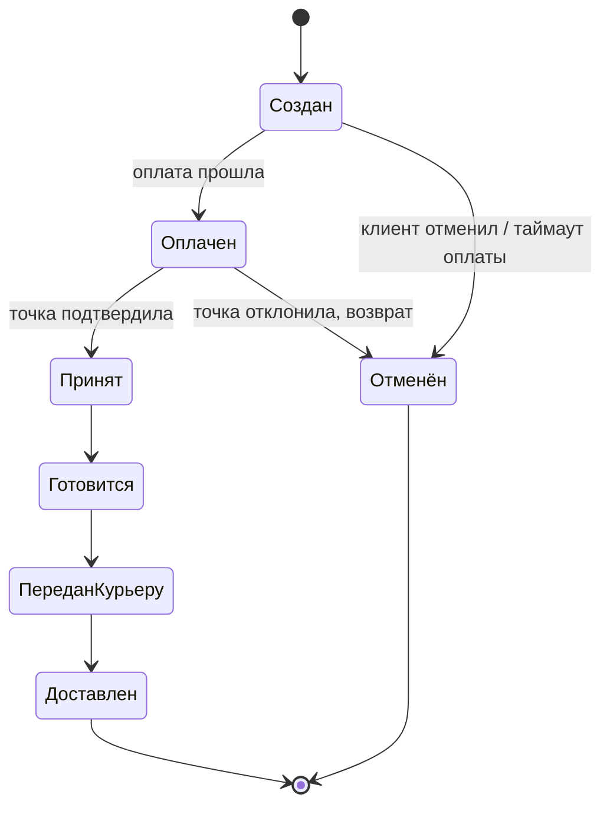

# Жизненный цикл заказа

| Переход | Кто инициирует | Что происходит в системе |
|---------|----------------|--------------------------|
| Создан → Оплачен | Платёжный шлюз (callback) | Фиксация платежа, отправка заказа в POS |
| Оплачен → Принят | Администратор точки / POS | Подтверждение, расчёт времени готовности |
| Готовится → ПереданКурьеру | Бариста / курьер | Назначение курьера, уведомление клиенту |
| Любой → Отменён | Клиент / администратор / система | Возврат средств по правилам отмены |
